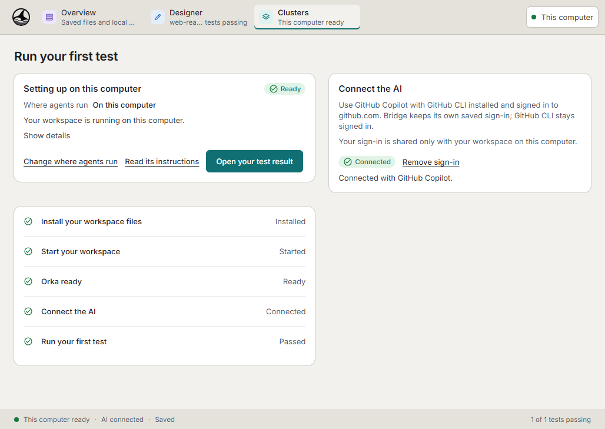
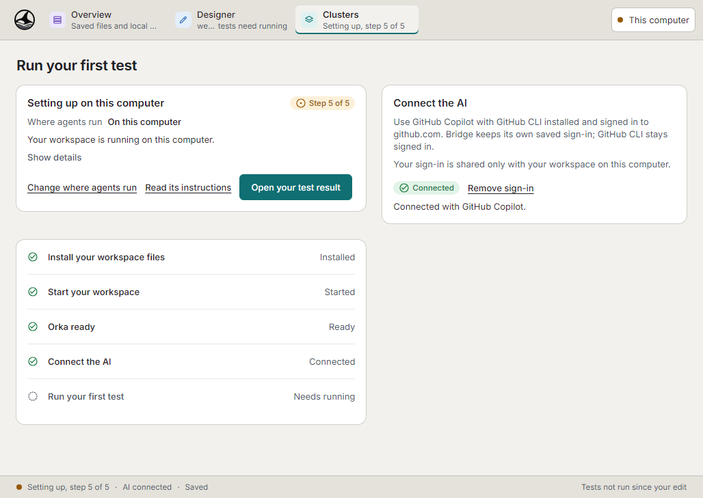
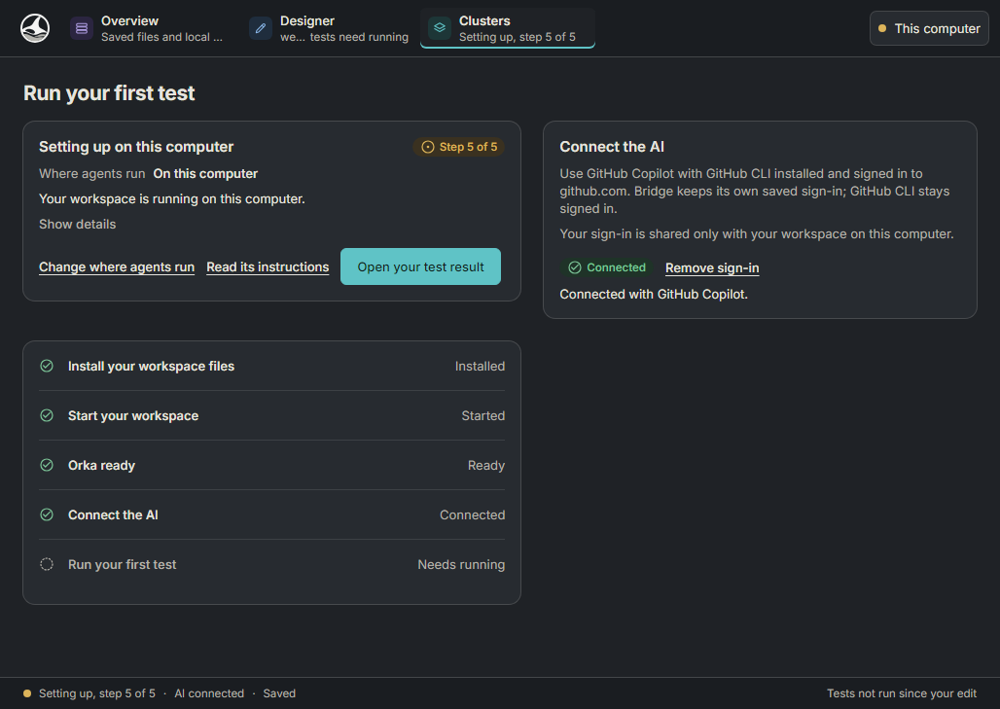
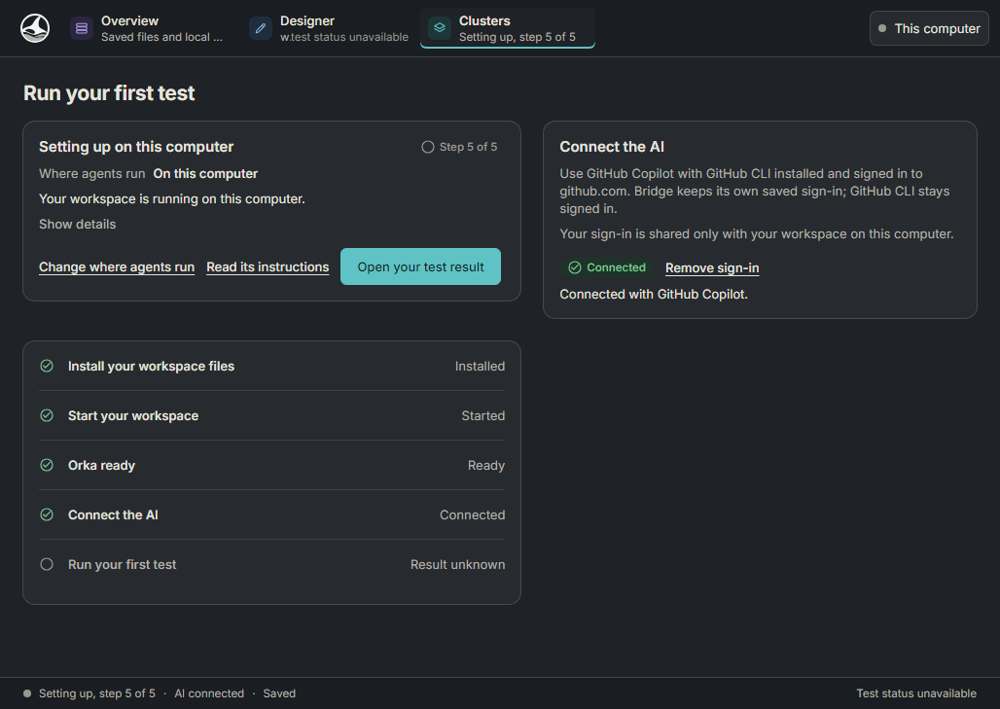
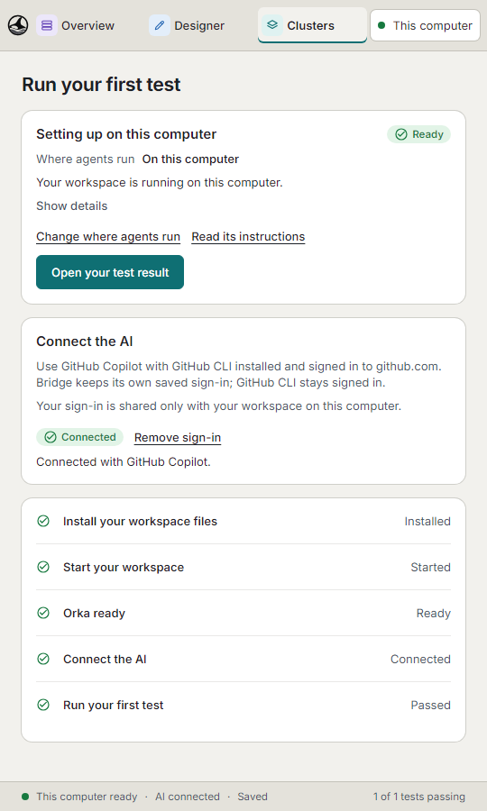
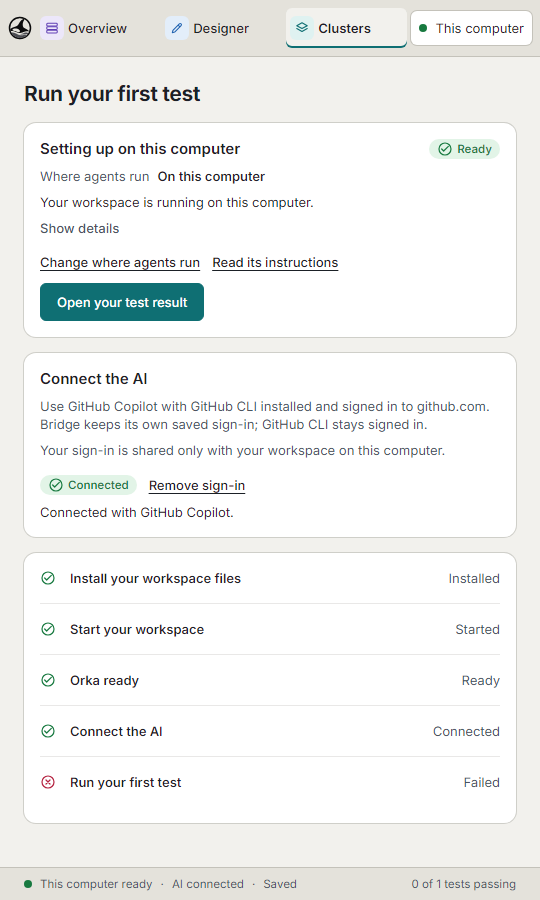
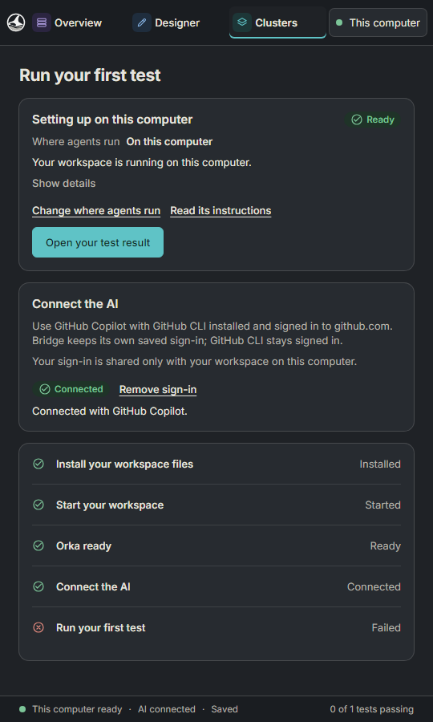
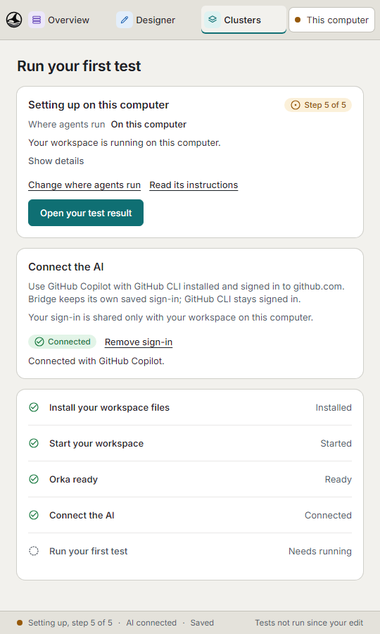
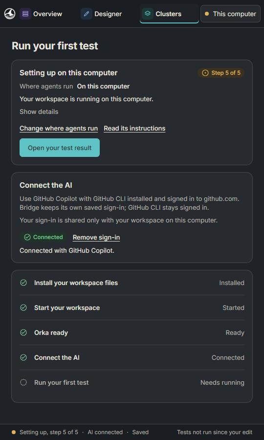
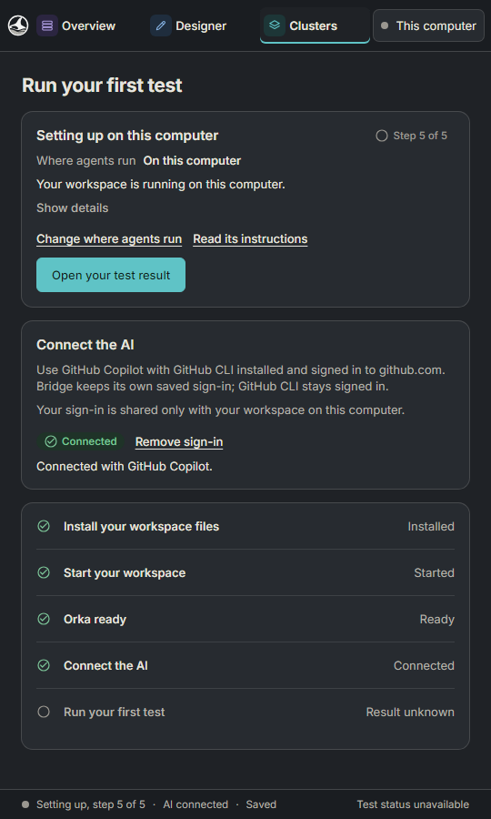

# Native sample-test badges

Bridge revision [`19f2bb0a758f13a97612cf6889028e950f8b847b`](https://github.com/orka-agents/orka-bridge/commit/19f2bb0a758f13a97612cf6889028e950f8b847b), captured by [App CI](https://github.com/orka-agents/orka-bridge/actions/runs/43467415768). Both native renderer/lifecycle artifact head files match that revision.

These are **synthetic IPC states rendered by the compiled Windows app in its native WebView2**, not a browser preview or proof of real sign-in, model inference, VM or cluster recovery. System themes are emulated inside WebView2; no desktop setting was changed. The capture waits for each sample badge before taking its image.

Wide content is 1028×729 pixels. Compact captures resize the actual native window to a 540×900 CSS-pixel client area, devicePixelRatio 1. Click an image for full size.

## Wide

| Sample test state | Light | Dark |
|---|---|---|
| Passed |  |  |
| Failed |  |  |
| Edited / needs running |  |  |
| Unreadable / result unknown |  |  |

## Compact

| Sample test state | Light | Dark |
|---|---|---|
| Passed |  |  |
| Failed |  |  |
| Edited / needs running |  |  |
| Unreadable / result unknown |  |  |
