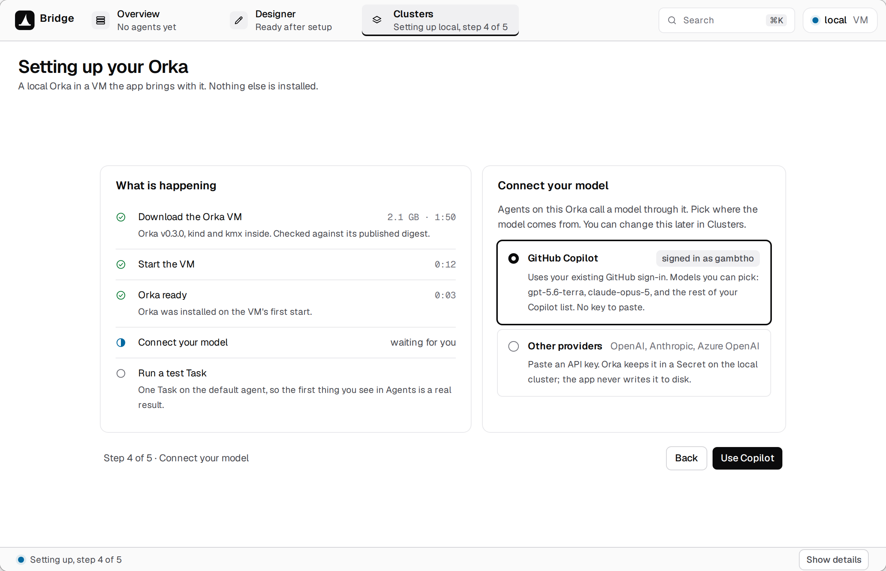
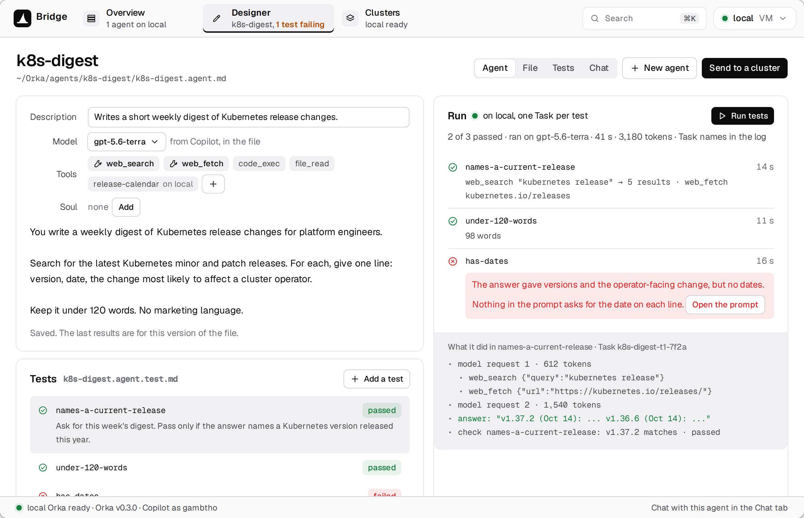
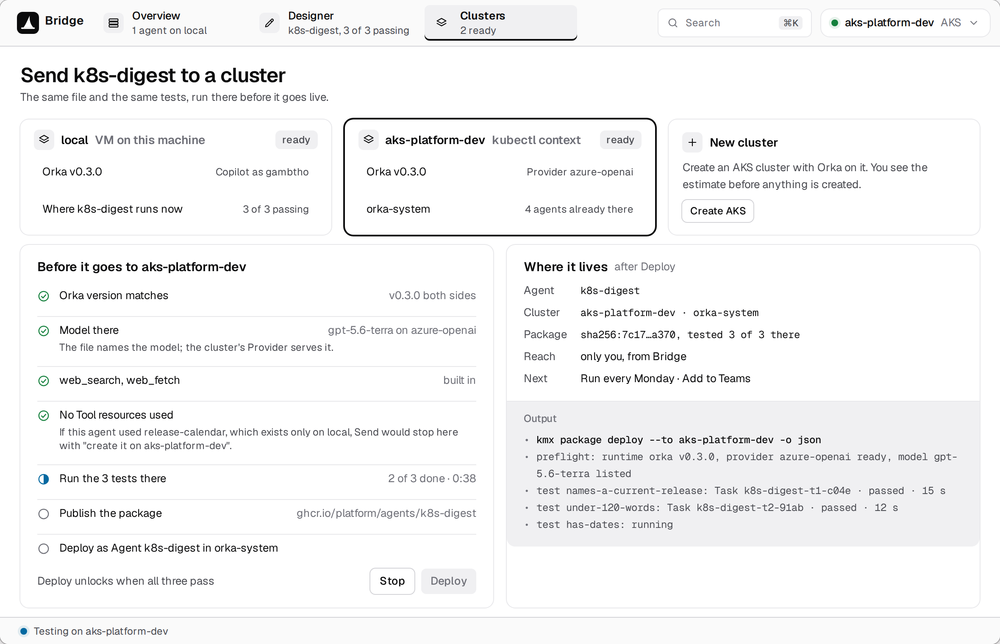
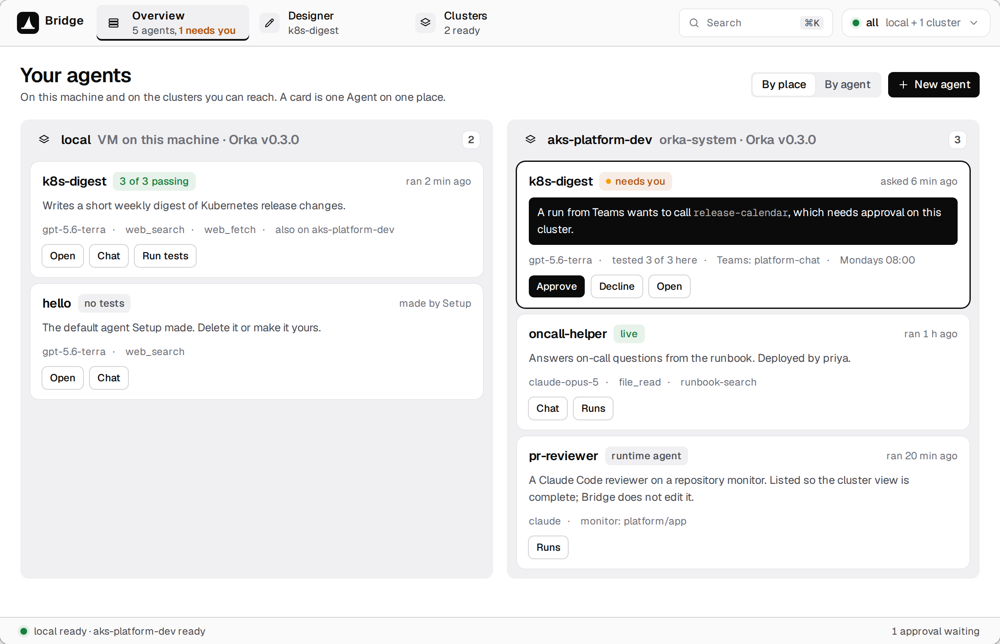

# Bridge roadmap

Bridge gives you a controlled place on your own laptop to build and test agents for
[Orka](https://github.com/orka-agents/orka), an open-source platform that runs AI agents on Kubernetes clusters. Bridge
then sends the same agent to your team's cluster. It's for people who want to try an agent idea without first setting up
a cluster, installing Orka and connecting a model. With the local VM, the agent runs inside the VM, not directly on your
machine, and Bridge copies in only the agent and its test files. The agent is offered only the tools it declares, and
your model credentials stay out of agent files.

This page shows the path a new user takes, in the order we're building it, and where each part stands. Each stage ends
with **Ideas wanted**: design questions we'd like help with. The screenshots are design mockups; the names, sizes, times
and token counts in them are made up.

Bridge runs on Apple-silicon Macs and on Windows x64 PCs.

| Stage | What you get | Status |
|---|---|---|
| 1. First run | Open Bridge, start a local VM, sign in with Copilot, land on an example agent | In progress |
| 2. Edit and test | Change the agent and run its tests on the local Orka | Next |
| 3. Send | Run the same tests on your team's cluster and keep the agent there if they pass | After stage 2 |
| 4. Overview and more | Your agents across places, existing clusters, more model providers, the second hour | Later |

## 1. First run (in progress)

**You do:** Open Bridge for the first time and choose to start a local VM. Sign in with GitHub Copilot.

**Bridge shows:** One setup screen with progress while it downloads the VM image, starts the VM and brings up Orka. It
then runs one short test task through your model, shows Ready and opens an example agent in the Designer.

Where it stands:

- **VM image** ([#8](https://github.com/orka-agents/orka-bridge/issues/8)): built for both platforms from pinned inputs. The Windows image passes its boot checks; the Mac image is
  finishing the same checks.
- **Mac VM:** runs under Apple's Virtualization framework. A full boot test on a real Mac is next.
- **Windows VM:** runs under QEMU with Windows Hypervisor Platform. The pinned QEMU build is done; the code that starts
  and controls the VM is in progress.
- **Copilot sign-in reaching the VM:** designed and being built. Your credential is kept away from agent code inside the
  VM.
- **The first-run screen itself:** designed, and built once the VM boots on both platforms.

**Ideas wanted:**

- How should the choice be worded for someone who doesn't know what a cluster is?
- The download is large: Orka's images and the Kubernetes node image are about 800 MB compressed, before the VM's
  operating system. How do we show the size and the wait?
- What should the sign-in flow look like, and where does it hand off to the browser?
- When you reopen Bridge, Ready means a quick health check passed, and a fresh test task runs only when you ask. Is that
  clear, and how do we show when the last real test ran?

## 2. Edit and test an agent (next)

**You do:** Open the Designer. The example agent has a prompt, a web tool and a test that only passes if the agent
really uses the tool. Change the prompt, choose tools, add a Soul (the agent's standing persona and tone) or Skills
(reusable blocks of instructions), then click Run.

**Bridge shows:** The agent's sections, saved as Markdown files in a Git repository. After Run: pass or fail for each
test, the tool calls the agent made, how long it took and how many tokens it used.

How it works: Bridge runs each test as an Orka Task on the local cluster and checks the answer itself. A Task that
finishes isn't a pass; the answer has to meet the test's checks. A prototype has already done this against Orka: a real
web fetch with the answer checked against the fetched page, a deliberately wrong check that failed, and recovery after
the app was killed mid-run without starting the Task twice.

**Ideas wanted:**

- Form fields, the raw file, or both side by side?
- How do people pick tools: Orka's built-in tools and the custom tools on the target cluster in one list, or separated?
- Where do Soul and Skills belong, and how much explanation do they need on screen?
- When a test fails, what should the person see first: the check that failed, the agent's answer, or the tool calls?

Part of this stage: the example agent's test must fail unless the agent really fetches its page
([#13](https://github.com/orka-agents/orka-bridge/issues/13)), and Skills belong in the Designer
([#4](https://github.com/orka-agents/orka-bridge/issues/4)).

## 3. Send to the team's cluster (after stage 2)

**You do:** Connect your team's cluster, choose it, and click Send.

**Bridge shows:** First, read-only checks: the cluster's Orka version, the model, and whether every tool the agent uses
is there. Then it creates a new version of the agent on that cluster, runs the same tests there, and keeps that version
if they pass. Sending an edited agent again makes another version. A missing custom tool stops Send; Bridge doesn't copy
or create it for you.

**Ideas wanted:**

- A tool or permission is missing on the destination. What do we say, and what can the person do next?
- Which version do teammates use, and what happens to older versions and to a version whose tests failed?
- How does a person tell a local pass from a pass on the team's cluster?

## 4. Overview and later

**Overview:** your agents grouped by where they run, the local VM and each connected cluster, with test status, tools
and recent runs.

Ideas for Overview and the Designer, each with its own issue:

- **Recent activity** across agents ([#31](https://github.com/orka-agents/orka-bridge/issues/31)).
- **Look inside a running agent** ([#32](https://github.com/orka-agents/orka-bridge/issues/32)).
- **Answer approval requests** from Overview ([#33](https://github.com/orka-agents/orka-bridge/issues/33)).
- **Stop, delete and pause** deployed agents ([#36](https://github.com/orka-agents/orka-bridge/issues/36)).
- **Limit which domains an agent can reach** ([#34](https://github.com/orka-agents/orka-bridge/issues/34)).
- **Resource limits and token use** per agent ([#35](https://github.com/orka-agents/orka-bridge/issues/35)).
- **A Models screen** for providers and the default model ([#37](https://github.com/orka-agents/orka-bridge/issues/37)).

Also later:

- **Connecting a cluster you already have,** without the local VM. Mac first; Windows after. Shared team clusters
  ([#10](https://github.com/orka-agents/orka-bridge/issues/10)) build on the namespace and role design in
  [#9](https://github.com/orka-agents/orka-bridge/issues/9).
- **API keys** for OpenAI, Anthropic or Azure OpenAI as an alternative to Copilot.
- **Updating the VM** when a new image ships, keeping your agents and tests.
- **The second hour:** running an agent on a schedule ([#1](https://github.com/orka-agents/orka-bridge/issues/1)),
  and reaching it from Teams or Telegram ([#3](https://github.com/orka-agents/orka-bridge/issues/3)). Teams needs a
  bot registration in your organization that Bridge can't do for you.
- **A faster local cluster:** k3s starts Orka about twice as fast as the current kind setup in early tests.
- **MCP tools in the Designer** ([#7](https://github.com/orka-agents/orka-bridge/issues/7)) and **copying Tool
  resources** between clusters ([#6](https://github.com/orka-agents/orka-bridge/issues/6)).
- **A Sessions screen** ([#5](https://github.com/orka-agents/orka-bridge/issues/5)).
- **Gateway adapters in the VM image** ([#12](https://github.com/orka-agents/orka-bridge/issues/12)) and **a temporary
  public address** for the local VM ([#2](https://github.com/orka-agents/orka-bridge/issues/2)).
- **The coding-agent experience** ([#11](https://github.com/orka-agents/orka-bridge/issues/11)).

**Ideas wanted:**

- What do you check day to day: did it run, did it fail, what did it cost?
- What should Overview show when a cluster can't be reached or its data is out of date?
- Which second-hour feature comes first, and where does it live?

Not planned for now: Intel Macs and Windows on Arm.
