# Designer: native desktop captures

Product revision: `370625f57ed53730ea0cacd0941a39c9d802c1c6`.
Source: [macOS bundle job, App run 43277281518](https://github.com/orka-agents/orka-bridge/actions/runs/43277281518).
The main gallery shows native macOS app windows, not browser previews. Desktop captures are 1280 px wide; compact captures are 540 px wide.

The walk opens the owned sample file before workspace readiness, edits it through Agent and File, verifies the exact saved bytes and Saved acknowledgement, opens More settings, and switches views at minimum width. UUID markers in the instructions are test edits, not product copy. The debug lifecycle walk separately checks retained edits through close/reopen and second launches in both themes.

| State | Light | Dark |
| --- | --- | --- |
| Agent: instructions, tools and model guidance | [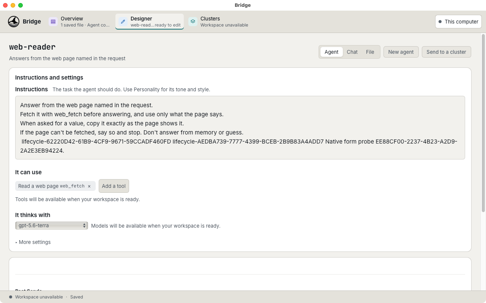](light-agent-view.png) | [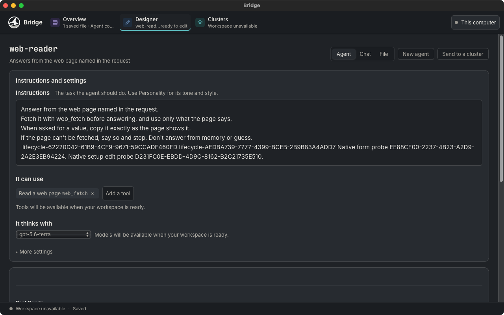](dark-agent-view.png) |
| File: path controls, syntax colouring and line numbers | [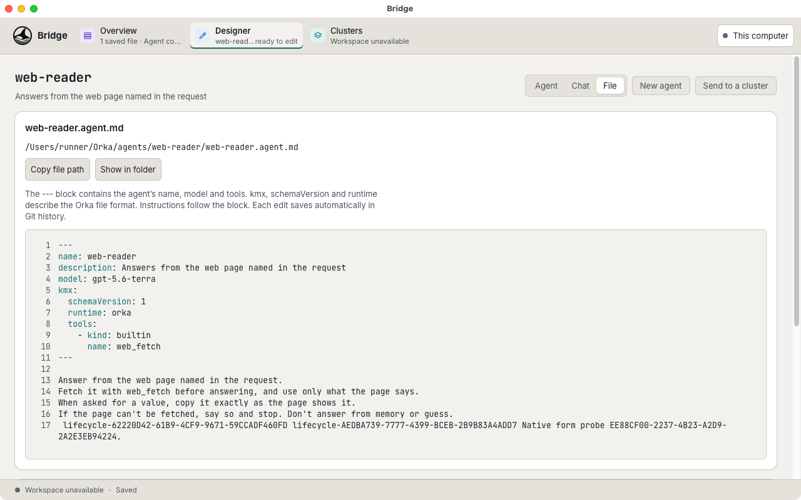](light-file-view.png) | [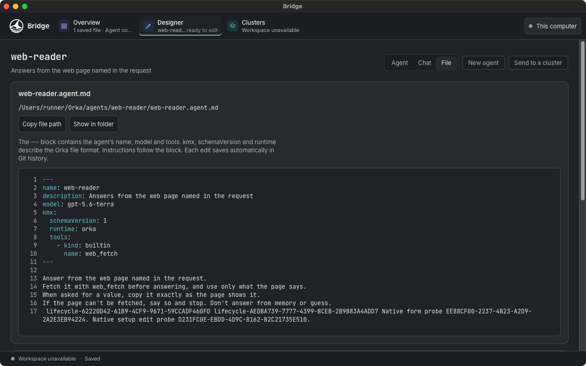](dark-file-view.png) |
| File: focused editor after a setup-time save | [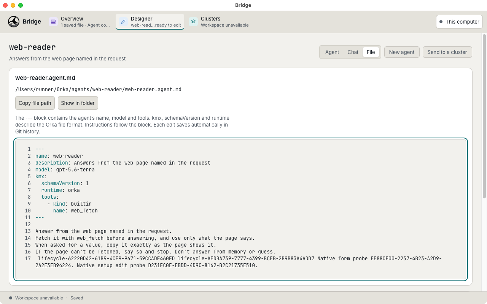](light-file-edited.png) | [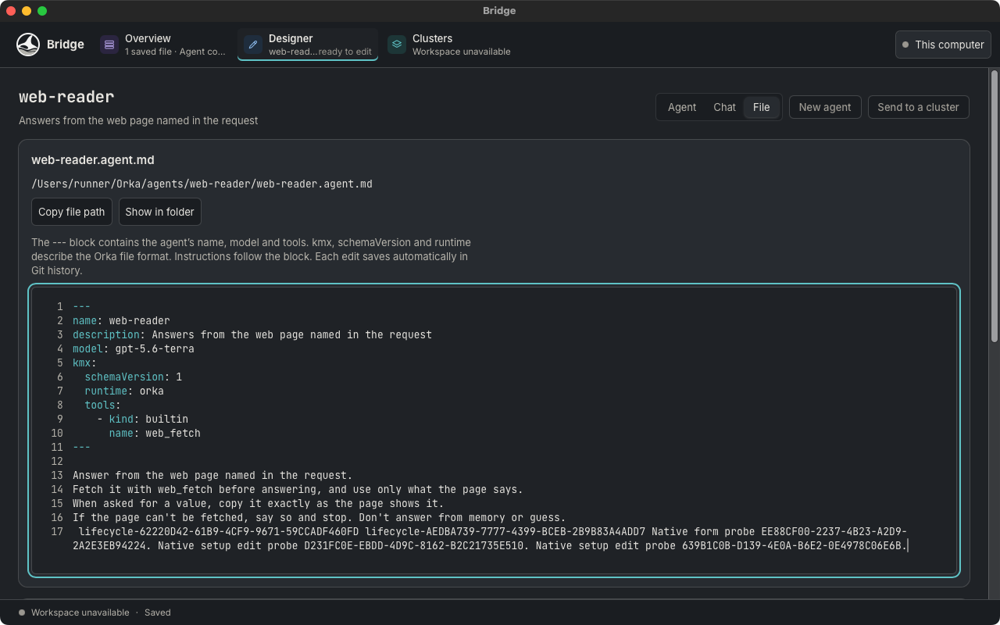](dark-file-edited.png) |
| More settings: Description, Personality and file location | [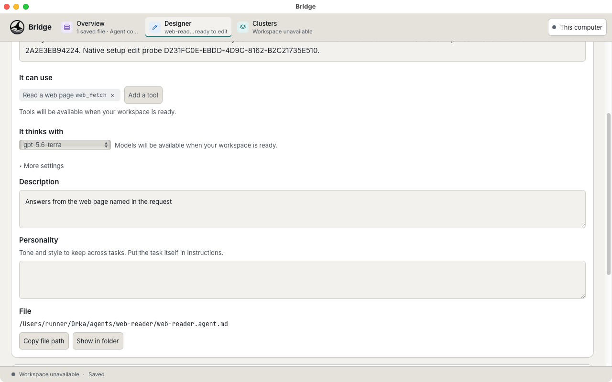](light-designer-settings.png) | [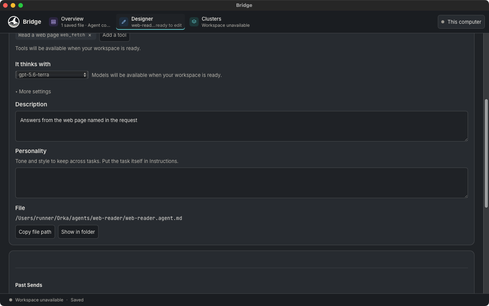](dark-designer-settings.png) |
| Compact Agent | [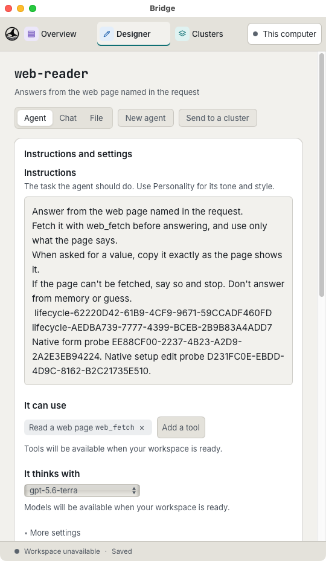](light-designer-compact.png) | [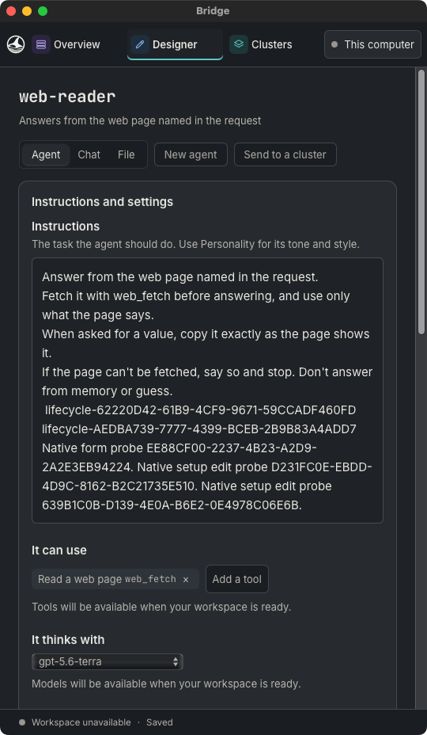](dark-designer-compact.png) |
| Compact File: wrapped lines without horizontal overflow | [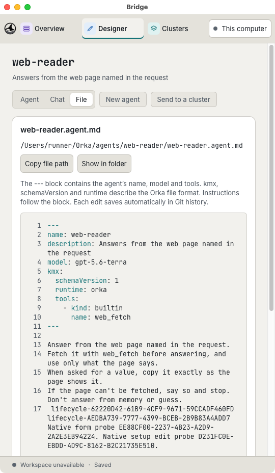](light-file-compact.png) | [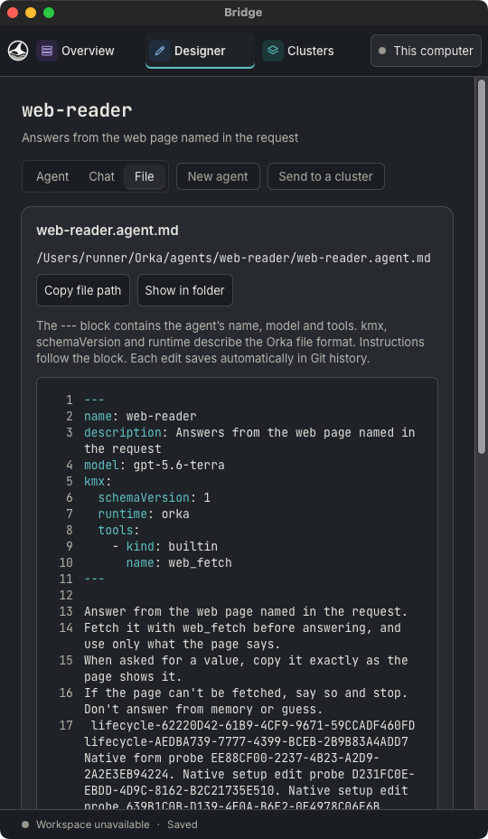](dark-file-compact.png) |

## Windows lifecycle

[App PR run 43277292469](https://github.com/orka-agents/orka-bridge/actions/runs/43277292469), associated with the same product head. Its checkout records tested merge revision `8742ead8f61a21e7c55dff6972777769e1ded68c`.
The native debug walk retained the File view and exact edited text through hiding, tray reopening and second launches in both themes. These hosted-CI captures include the Windows taskbar; they are not compact-width layout captures.

| Light | Dark |
| --- | --- |
| [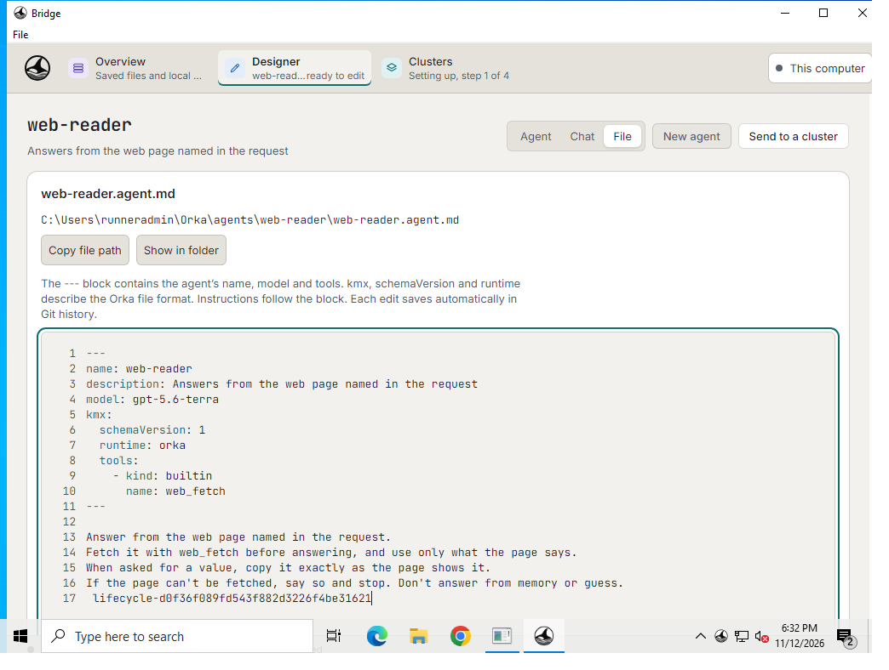](windows-light-reopened.png) | [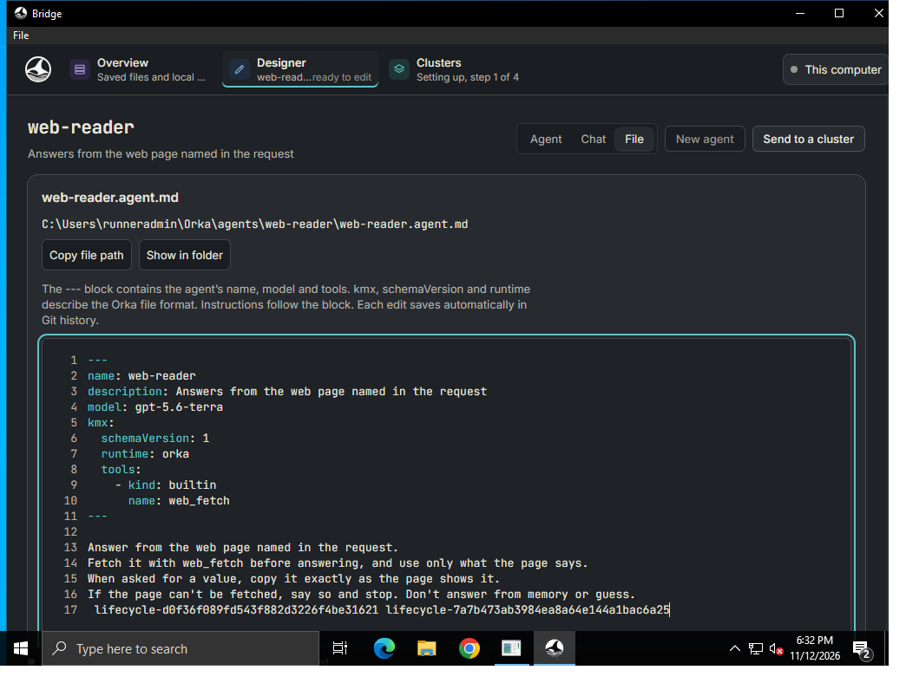](windows-dark-reopened.png) |

Limits: these captures do not prove a running VM, a real provider or cluster, a live catalog, native clipboard transfer, or Finder/Explorer navigation. The walk uses no real credentials and submits no workload.
