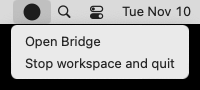
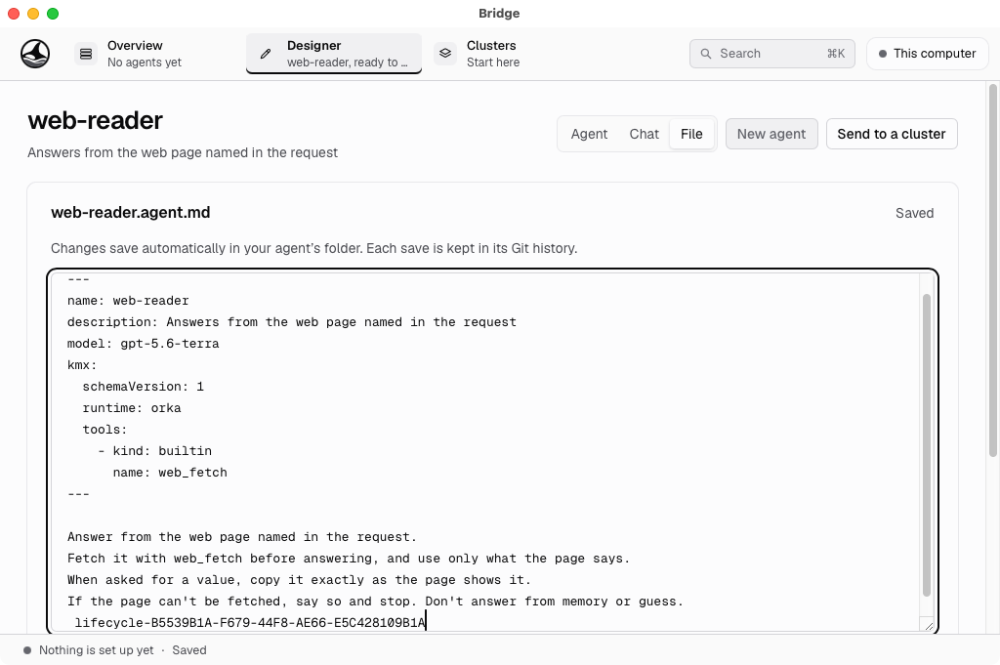
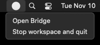
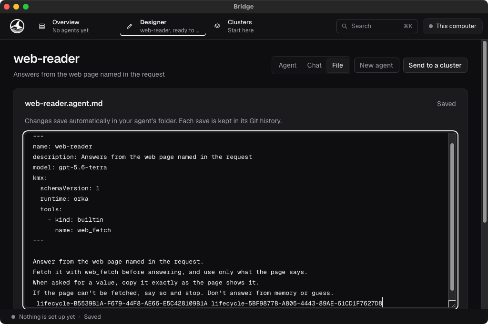
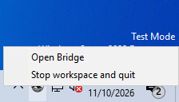
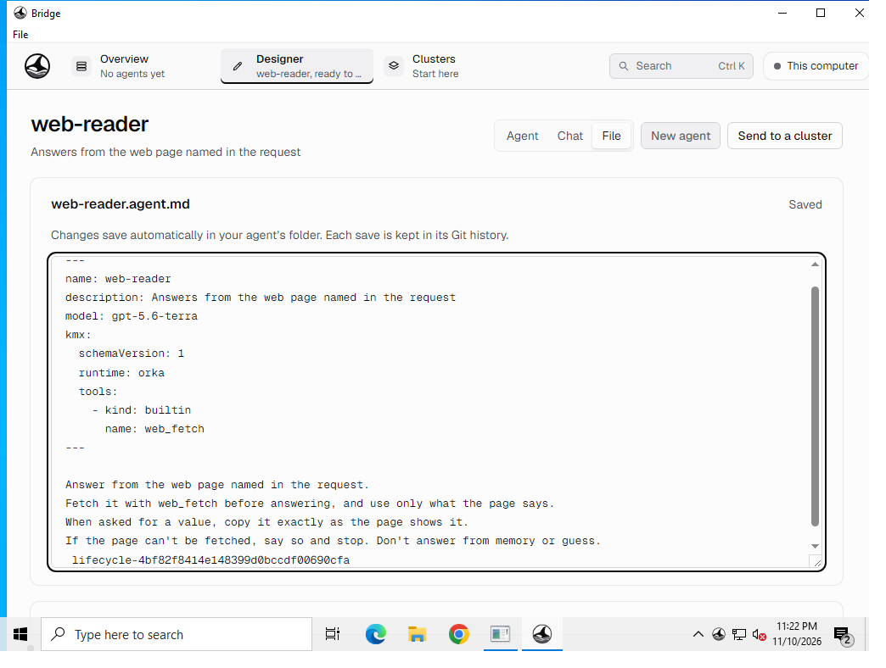
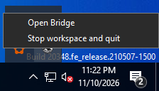
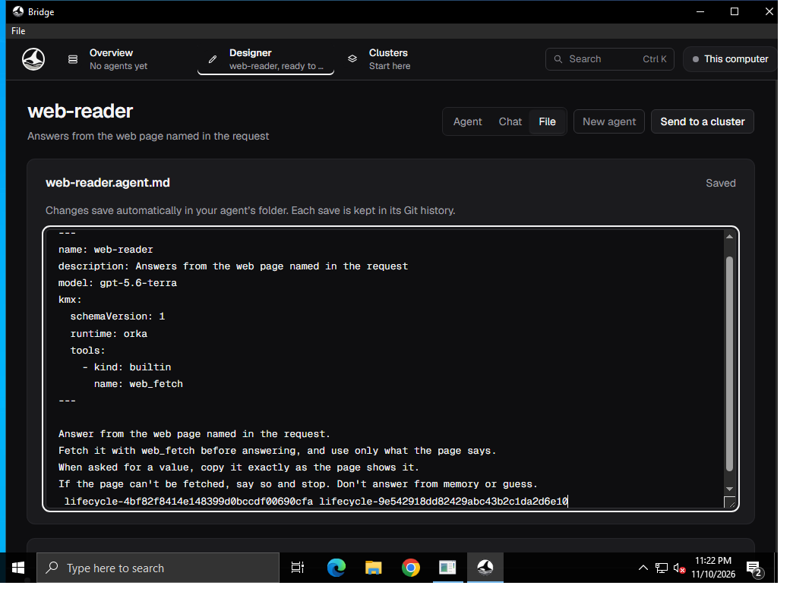

# Native Close and reopen

Captured from `41975ecadf268db55d4cc6e5362cd9580c6a434b` in [native CI](https://github.com/orka-agents/orka-bridge/actions/runs/42920328159).

Integrated debug shells with an empty image source and no saved workspace selection. These are real OS menus/windows, not a running VM or a simulated Ready state. Each walk checks the original process/native window, retained File view and edited text, hidden/minimized second launches, and native Stop. macOS also checks Dock-style activation and standard Quit; Windows File → Quit cleanup is covered by the native subprocess test.

Menu images are crops of the actual display capture; unrelated CI desktop/console content is omitted. Reopened-window captures are unchanged. Themes are rendered by the OS/application, not replaced in the images.

| Platform/theme | Menu after Close hides the window | Existing window after Open Bridge |
| --- | --- | --- |
| macOS light |  |  |
| macOS dark |  |  |
| Windows light |  |  |
| Windows dark |  |  |

Not evidence of live VM/model retention, sleep/wake, actual host sign-out or poweroff, or release qualification.
